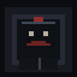

# Этаж, которого нет

[](https://github.com/JeySerYT/the-floor-that-isnt-there/actions/workflows/tests.yml)


Короткий сюжетный 2D-хоррор с видом сверху: Марк ищет Леру в больнице
«Белый шум» и попадает на этаж, которого нет в плане здания. Пиксельная
графика, подвал, три концовки.

**18+.** Кровь, смерть, психологическое насилие, намёки на близость.
Откровенных сцен и сексуализированного насилия нет.

## Содержание

- [Установка](#установка)
- [Быстрый старт](#быстрый-старт)
- [Управление](#управление)
- [Свет, шум и укрытия](#свет-шум-и-укрытия)
- [Подвал и третий финал](#подвал-и-третий-финал)
- [Конфигурация](#конфигурация)
- [Разработка](#разработка)
- [Структура](#структура)
- [Участие](#участие)
- [Лицензия](#лицензия)

## Установка

Нужен Godot 4.7 (GL Compatibility). Движок не входит в репозиторий:
`.tools/` в `.gitignore`.

Самый короткий путь, если Godot уже в `PATH`:

```bash
git clone https://github.com/JeySerYT/the-floor-that-isnt-there.git
cd the-floor-that-isnt-there
godot --path .
```

Ручная установка движка в проект:

```bash
mkdir -p .tools
cp /path/to/Godot_v4.7-stable_linux.x86_64 .tools/godot
chmod +x .tools/godot
.tools/godot --path .
```

Из исходников: импортировать ресурсы и запустить; команды — в разделе
[Быстрый старт](#быстрый-старт). Текстуры и звук уже лежат в `assets/`
и `audio/`; пересборка описана в разделе [Разработка](#разработка).

## Быстрый старт

```bash
.tools/godot --headless --path . --import      # импорт ресурсов
.tools/godot --path .                          # запуск
.tools/godot --headless --path . --script res://tests/test_runner.gd
```

## Управление

| Клавиша | Действие |
|---|---|
| WASD / стрелки | движение |
| Shift | тихий шаг: медленнее и почти без шума |
| F | фонарь: включить или выключить |
| E | взаимодействие, укрытие, закрыть записку |
| Esc | пауза, закрыть окно выбора, настройки или титры |
| F11 | полный экран (включён по умолчанию) |

## Свет, шум и укрытия

Фонарь включён по умолчанию. С ним видно весь этаж, но медсестра замечает
игрока на расстоянии до 300 px. Без фонаря вокруг игрока остаётся круг
обзора около 110 px, а радиус обнаружения падает до 80 px.

Обычная ходьба слышна в радиусе 170 px, тихий шаг (Shift) — 60 px при 60%
скорости. Взаимодействия и открывающиеся двери дают шум 240 px. Услышав
шум, медсестра идёт к источнику, ищет там 4 секунды и возвращается
к патрулю. Потеряв игрока из виду во время погони, она тоже идёт к последней
замеченной точке, а не преследует бесконечно.

Спрятаться можно в металлическом шкафу в щитовой и под кроватью в палате 13.
В укрытии игрока нельзя поймать. Если медсестра видела, как он прятался,
она подходит, проверяет укрытие 3 секунды и уходит.

## Подвал и третий финал

Когда питание включено, в холле открывается лестница вниз. Под землёй —
коридор, архив и котельная: пять записок и вторая кассета. Каждая находка
попадает в дневник, а собранное целиком открывает дверь «−1» в котельной
и третий вариант в служебном лифте.

При входе в котельную гаснет свет: фонарь выключается, а медсестра
оказывается у двери. Финал «ПРАВДА» доступен только при полном собрании;
из него открываются титры. Правая нижняя часть подвала замурована —
прохода туда нет.

## Конфигурация

Настройки лежат в `user://settings.json` (на Linux —
`~/.local/share/godot/app_userdata/Этаж, которого нет/`):

| Ключ | Значение |
|---|---|
| `fullscreen` | полный экран при запуске |
| `master_volume` | общая громкость, 0–1 |

Игра всегда стартует в полном экране; F11 или настройки возвращают окно
1280×720. Полный экран подстраивается под монитор: если разрешение делится
на 640×360 нацело, картинка рисуется с целым масштабом (1920×1080 → ×3,
1440×900 → 720×450 при ×2), иначе включается дробный масштаб с заполнением
всего экрана. Чёрных полос нет ни в одном из случаев.

Прогресс хранится отдельно в `user://savegame.json`, версия 3. Координаты
старого формата (мир 320×180) умножаются на 2 при загрузке, а расплывчатые
цели сейвов версий 1–2 пересобираются из флагов. Автосохранение каждые
30 секунд и на ключевых событиях; сейв удаляется после финала.

Базовое разрешение 640×360, окно 1280×720, nearest filtering, тайлы 32×32.

## Разработка

Тесты:

```bash
tests/run_all.sh
```

Скрипт импортирует ресурсы и прогоняет четыре набора: юнит-проверки,
регрессию сюжета, свет/шум и подвал. Проверяются новая игра, флаги
и инвентарь, сохранение и загрузка, миграция сейвов v1 → v3, настройки,
правила света и шума, полнота записок для третьего финала и наличие всех
файлов из манифеста.

Релиз публикуется автоматически по тегу: workflow `Release` берёт заметки
из `CHANGELOG.md` через `scripts/release_notes.py` и создаёт релиз на GitHub.
Тег с дефисом (`vX.Y.Z-alpha.1`) помечается как prerelease.

```bash
git tag vX.Y.Z
git push origin vX.Y.Z
```

Ассеты генерируются детерминированно, сторонних файлов нет:

```bash
python3 tools/generate_textures.py   # окружение, партия 1
python3 tools/generate_props.py      # предметы и мебель, партия 2
python3 tools/generate_characters.py # листы персонажей, партия 3
python3 tools/generate_ui.py         # UI, бумага, логотип, титул, партия 4
python3 tools/generate_basement.py   # подвал, архив, котельная, партия 5
python3 tools/generate_audio.py      # WAV
```

`assets/textures/manifest.json` хранит ID, размеры, `batch`, кадры и
nine-patch-марджины. Генераторы мержат манифест, поэтому партии можно
пересобирать по отдельности. Превью: `tools/mock_scene.py`,
`tools/mock_props.py`, `tools/mock_characters.py`, `tools/mock_ui.py`.
Зависимости: Python 3, Pillow, numpy.

## Структура

```
.github/workflows/    CI и публикация релизов
assets/audio/         сгенерированные WAV
assets/textures/      тайлы, мебель, двери, декали, персонажи, UI
docs/previews/        контактные листы и макеты партий
docs/specs/           спеки версий
scenes/               main, world, player
scripts/              main, world, player, enemy, interaction, darkness
scripts/autoload/     GameState, AudioManager, UserSettings
scripts/ui/           GameUI
scripts/release_notes.py  заметки релиза из CHANGELOG
tests/                headless-тесты
tests/scenarios/      сценарные регрессии
tools/                генераторы текстур, звука и превью
```

## Участие

Правила сборки и PR — в [CONTRIBUTING.md](CONTRIBUTING.md). Об уязвимостях
сообщайте приватно по [SECURITY.md](SECURITY.md); правила общения —
в [CODE_OF_CONDUCT.md](CODE_OF_CONDUCT.md).

## Лицензия

[MIT](LICENSE), © 2026 JeySerYT.